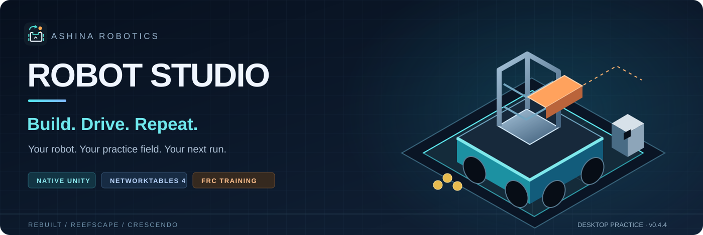
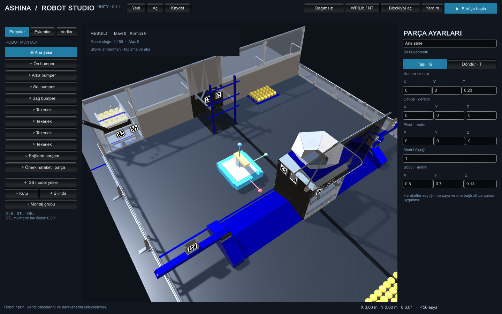
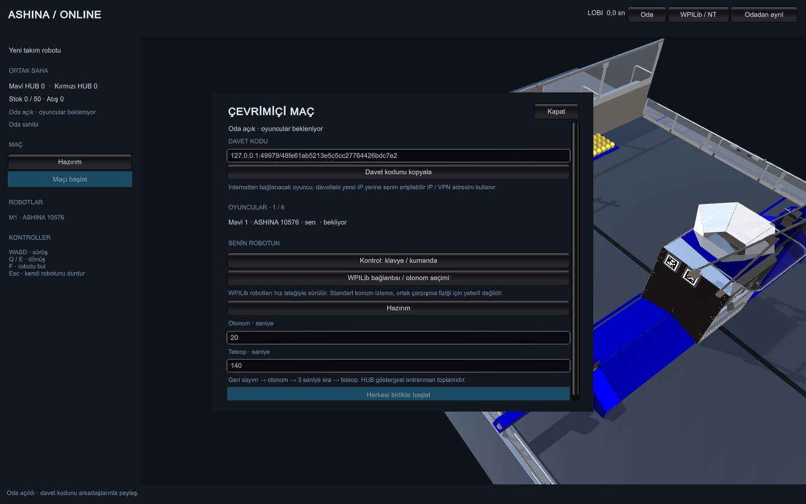
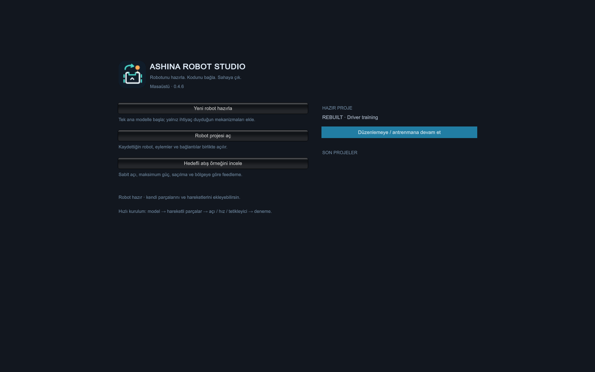
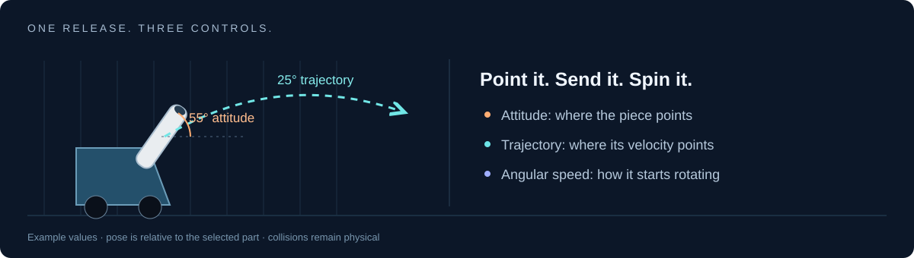
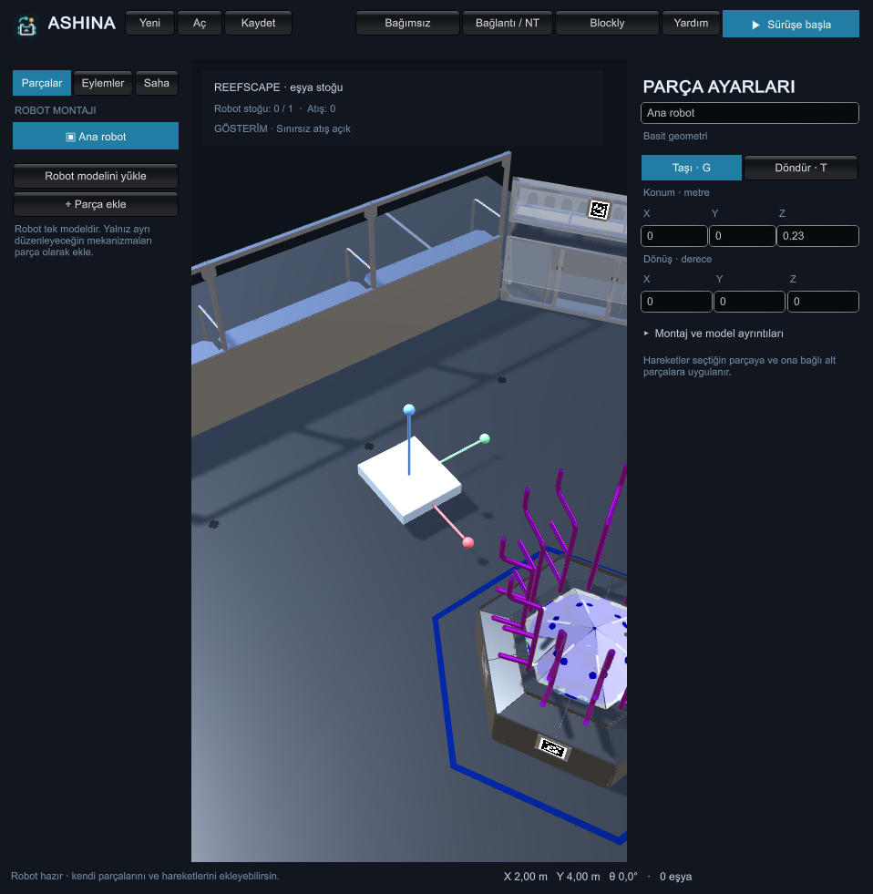

<p align="center">
  
</p>

<p align="center">
  <a href="https://github.com/deniz41-justacceptmyusername/ashina-robot-studio/releases/latest"><strong>Download for Windows</strong></a>
  &nbsp; · &nbsp; <a href="docs/quickstart.md">Quick start</a>
  &nbsp; · &nbsp; <a href="docs/networktables.md">Connect WPILib</a>
  &nbsp; · &nbsp; <a href="README.tr.md">Türkçe</a>
</p>

<p align="center">
  
  
  
  
  <a href="LICENSE"></a>
  <a href="https://github.com/deniz41-justacceptmyusername/ashina-robot-studio/actions/workflows/verify.yml"></a>
</p>

# Your robot. Your practice field.

**Ashina Robot Studio is a native Unity desktop simulator for FRC driver training.** Assemble a robot from CAD, record mechanism motion, bind controls, and practice with physical game pieces. Connect a real WPILib simulation through NetworkTables when you want your own robot code to drive the session.

The focus is a quick path from a robot idea to a useful practice run: configurable mechanisms, approachable physics, and live robot data.

<table>
<tr>
<td width="33%"><strong>01 / BUILD</strong><br><br>Import GLB, STL, or OBJ. Set parents and pivots. Record motion with the 3D handles.</td>
<td width="33%"><strong>02 / CONNECT</strong><br><br>Browse NT4 topics, map live values to mechanisms, and feed controller input into WPILib.</td>
<td width="33%"><strong>03 / TRAIN</strong><br><br>Drive seasonal fields. Tune intake success, inventory, release attitude, and projectile speed.</td>
</tr>
</table>



## One field. Six robots.

Create a room from the home screen, share its invitation, and join with your own robot. Three blue and three red robots share chassis collisions, pieces, stock and a match clock. WPILib and manual players can mix. Your local code receives your robot's shared-world pose and camera data. Existing NT mechanism and shot mappings continue to work.

A separate headless Windows host supports six remote players. Use **İnternet odası aç** for friends on another network. The Windows package shares a temporary internet invitation. [Hosting and WPILib setup](docs/online.md).



## Run in a minute

1. Download **Ashina-Robot-Studio-0.4.9-Windows.zip** from [Releases](https://github.com/deniz41-justacceptmyusername/ashina-robot-studio/releases/latest).
2. Extract the entire folder and double-click **RobotStudio.exe**.
3. Create or open your robot from the home screen, then click **Sürüşe başla** and drive with **W A S D**, turn with **Q / E**, or use a supported gamepad.

Open `examples/REEFSCAPE-Coral-Lab.ashina.json` from the home screen for the REEFSCAPE release-angle demo. Press **Space** after starting the session. The standalone player needs no Unity Editor or Node installation. Running Java robot code additionally requires the matching WPILib development tools.

| Control | Action |
| --- | --- |
| W A S D / left stick | Drive |
| Q / E / right-stick X | Turn |
| I / LB | Collect FUEL in the REBUILT example |
| Space / RB | Shoot FUEL in the REBUILT example |
| Space | Release coral in Coral Lab |
| Right mouse / wheel / middle mouse | Orbit / zoom / pan |
| F / Esc | Find robot / stop driving |

## Home, setup, and one general shot system

The application opens inside a lit regional-style practice hall. Large controls sit on a translucent lower-left panel, with the 3D field on the right. Empty red/blue bleachers, roof trusses, LED fixtures and a field-crew desk surround the arena. The lightweight venue also appears during practice. Four setup steps load/scale a model, optionally add moving mechanisms, map live parameters, and configure a shot. Any part rotation/position or shot pitch/yaw/speed can use a published NT value, with explicit units and reference frames.

Choose the muzzle in the first shot-guide step. In the next step, each field half or custom region can have its own editable target. Intake uses a separate movable, resizable scene volume. Choose the muzzle in the first shot-guide step. In the next step, each field half or custom region can have its own editable target. Intake uses a separate movable, resizable scene volume. Choose the muzzle in the first shot-guide step. In the next step, each field half or custom region can have its own editable target. Intake uses a separate movable, resizable scene volume. Offline shots use a fixed direction, a picked point, or field regions with different targets. **Point aiming preserves the normal elevation**, respects maximum power, and adds configured scatter. Feed your side with the same emitter. Live code values take priority.



## Terrain and contact

The robot now has a dynamic chassis with four suspension contacts: it pitches and rolls on ramps, pushes loose FUEL through actual collisions, and loses drive traction when airborne. All six REEFSCAPE cages swing from a constrained suspension. Intake is a robot action attached to a mechanism, with its mouth settings tucked into a detail panel. The new compact robot-and-ball mark appears in the application and Windows icon.

## The release angle is yours

**Where a game piece points and where it travels are separate settings.** A coral can leave at a 55° attitude while its velocity follows a 25° trajectory. It can also remain horizontal while moving upward.



In **Eylemler**, select an emission action and open **Ayrıntılar → Çıkış duruşu → Bağımsız açı**. Set the piece's inclination, heading, and axial rotation. These angles are relative to the selected robot part. Optional coral angular speed is separate again; set it to **0** for a release without initial tumbling.

```json
{
  "orientationMode": "custom",
  "piecePitch": 55,
  "pieceYaw": 0,
  "pieceRoll": 0,
  "pitch": 25,
  "yaw": 0,
  "coralSpin": 0
}
```

The 55° and 25° values are demonstration settings. Enter the angles for your own mechanism. After release, collisions and the chosen angular velocity determine the piece's motion.

## One main robot. Add only what moves.

The default project and both examples start with **one main robot**. **Robot modelini yükle** replaces its CAD without adding a second base. **Parça ekle** adds an optional mechanism. Fixed wheels and bumpers do not fill the part list. Existing custom mechanisms survive a main-model replacement; a failed import preserves the current project.

## Bring your own mechanisms

- **CAD workflow:** GLB, STL, and OBJ import; split GLB assemblies into editable parts; configure hierarchy, scale, and pivot.
- **Motion workflow:** record a start and an end pose, then bind the motion to a keyboard key, controller button, Blockly output, or NT value.
- **Intakes:** box or sphere contact regions, success probability per contact entry, and an inventory capacity.
- **Emitters:** game-piece type, release point, trajectory, velocity, independent initial attitude, and optional stock consumption through training mode.
- **Showcase mode:** enable **Sınırsız atış · gösterim** to emit with empty inventory. Turn it off to return to normal stock rules.
- **Portable projects:** save geometry, actions, camera configuration, and mappings in a single `.ashina.json` file.

## Drive your actual WPILib code

Start your robot's desktop simulation, open **WPILib / NT**, and connect to `127.0.0.1:5810` or your chosen server. You can also select a Java Gradle project in the application and launch it there.

| Path | What happens |
| --- | --- |
| Observe robot pose | Unity follows the pose produced by your robot simulation. |
| Apply chassis requests | Unity applies published robot-relative chassis-speed requests to its simple drive model. |
| Map mechanism data | Numeric values, booleans, arrays, and supported struct fields control recorded actions. |
| Forward controllers | The Java bridge exposes gamepads to existing WPILib Xbox-controller bindings. |
| Simulate vision | Geometric AprilTag results can feed PhotonCamera / PhotonPoseEstimator through the supplied bridge. |

NetworkTables carries published data. Your project still needs the appropriate simulation IO and topic mappings. The [integration guide](docs/networktables.md) covers pose ownership, controllers, vision, and shooter setup. Field2d, common pose/speed structs, and published nested struct schemas are supported; unknown raw/protobuf messages are retained without promising custom field decoding for every format.

## Three seasons. One workspace.

| Season | Included practice content |
| --- | --- |
| **2026 · REBUILT** | Official field geometry and tags, 456 physical FUEL positions, intake probability, HUB-entry counters, and optional ball return. |
| **2025 · REEFSCAPE** | Field and tags, physical coral/algae types, and the Coral Lab release-attitude demo. |
| **2024 · CRESCENDO** | Field, tags, and the note game-piece type. |

Default training capacities are **50** for REBUILT and **1** for REEFSCAPE. They are editable. This is free practice; complete FMS timing, officiating, and full competition-rule enforcement are outside the current implementation.



## Built, exercised, documented

Version **0.4.9** passed **283 checks** plus a separate end-to-end Cloudflare internet room run. The build completed with **0 errors and 0 warnings**. [Read the validation record](docs/validation.md).

Repository CI checks source layout, example integrity, documentation links, and public-package hygiene. It does not claim to run the licensed Unity Editor or a team's private robot fixture. Physical controller models have not all been tested. Vision is geometric rather than pixel image processing; drive and game-piece collisions are training approximations.

A 5–10 minute setup is the goal for a prepared model and already-published robot values. CAD cleanup, unpublished IO and real shot calibration can take longer. [Online rooms](docs/online.md) support temporary internet invitations, local rooms and direct self-hosting.

## Explore the source

```text
Unity/             Unity 6000.1.13f1 project
integration/java/  WPILib controller, vision, and ideal swerve IO helpers
examples/          Generic REBUILT and REEFSCAPE robot projects
docs/              Quick start, architecture, integration, and screenshots
scripts/           Windows build and repository verification
verification/      Sanitized local validation records
```

Open `Unity/` in Unity Hub, or use the [Windows build instructions](docs/building.md). See [CONTRIBUTING.md](CONTRIBUTING.md) for a focused contribution workflow.

## License & credits

Project code is available under the **MIT License**. Third-party components and seasonal assets keep their own licenses; see [THIRD_PARTY_NOTICES.md](THIRD_PARTY_NOTICES.md).

Built with Unity, [WPILib](https://github.com/wpilibsuite/allwpilib), [AdvantageScope Assets](https://github.com/Mechanical-Advantage/AdvantageScopeAssets), [PhotonVision](https://github.com/PhotonVision/photonvision), and [Blockly](https://github.com/google/blockly). This is an independent community project, unaffiliated with FIRST.

