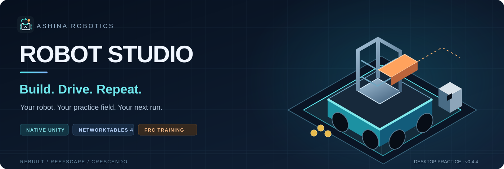
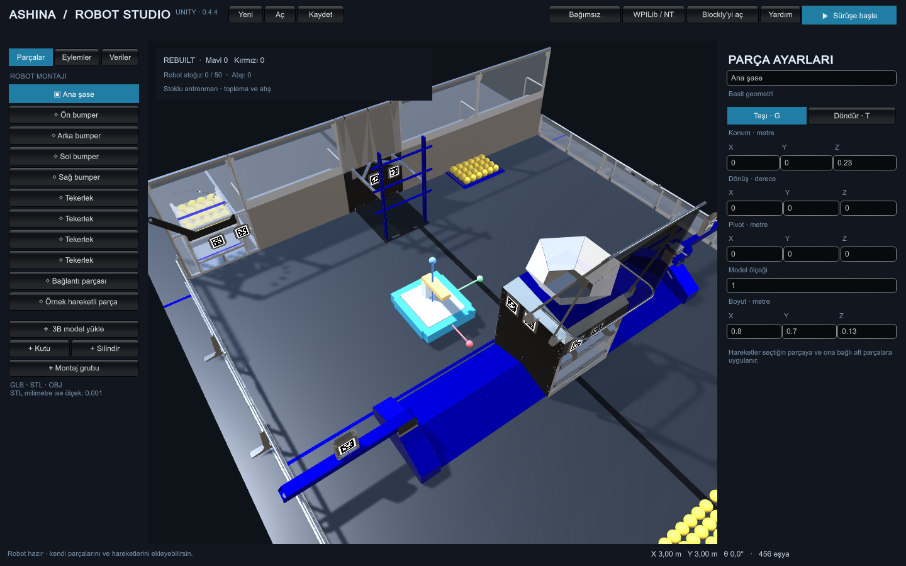
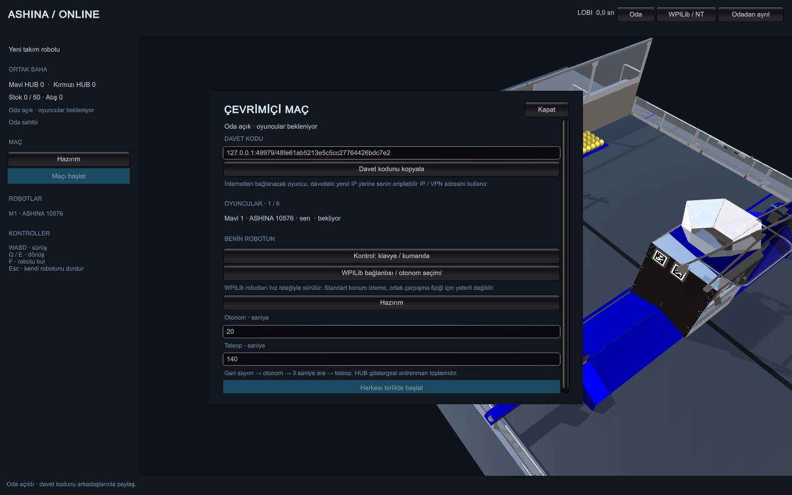
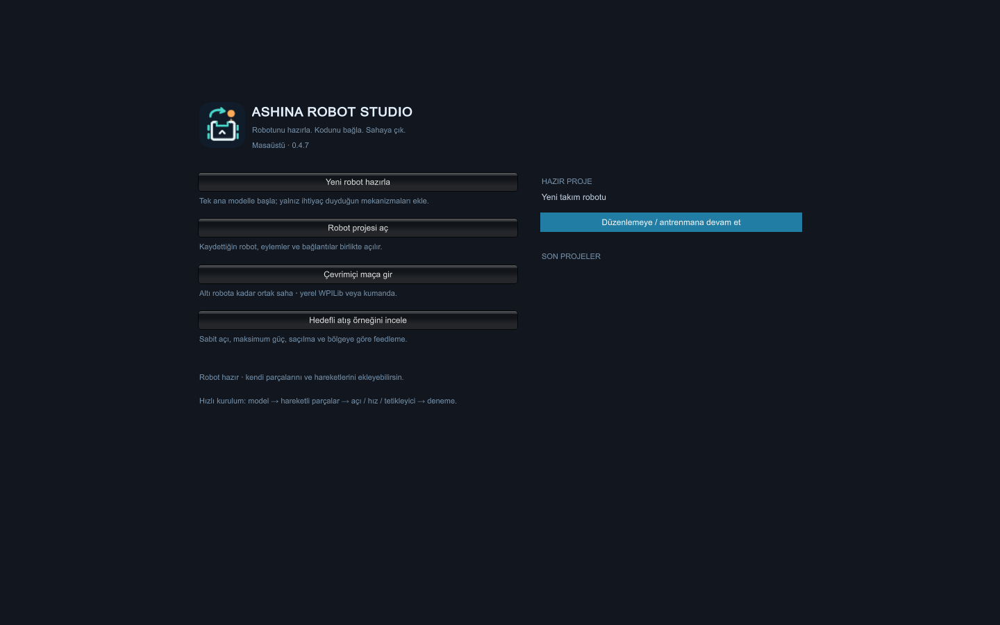
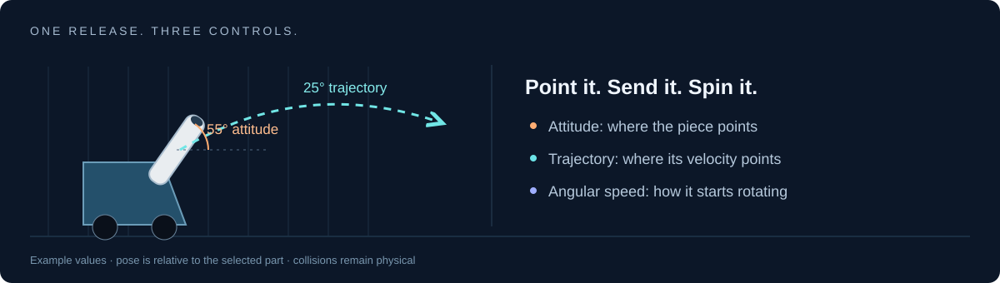

<a href="https://github.com/deniz41-justacceptmyusername/ashina-robot-studio/releases/latest"><strong>Windows sürümünü indir</strong></a> · <a href="README.md">English</a> · <a href="docs/networktables.md">WPILib bağlantısı</a>

# Robotunu kur. Sürüşe geç.

**Ashina Robot Studio**, FRC sürücü antrenmanı için Unity tabanlı bir Windows masaüstü uygulamasıdır. Kendi CAD parçalarını yükleyebilir, mekanizma hareketleri kaydedebilir ve gerçek WPILib simülasyonundan gelen verilerle çalışabilirsin.

## Ortak sahada altı robot

Ana ekrandan **Çevrimiçi maça gir** → oda oluştur → daveti paylaş. Oyuncular kendi robotlarıyla katılır; üç mavi ve üç kırmızı robot ortak çarpışma, top, stok ve maç saatiyle çalışır. Herkes hazır olunca otonom ve teleop birlikte başlar. WPILib ve kumanda kullanıcıları aynı odada bulunabilir.

Ayrı Windows sunucusu altı yerin tamamını uzaktan gelen oyunculara ayırır. İnternet için erişilebilir sunucu/VPN adresi gerekir; otomatik genel oda/relay hizmeti bulunmaz. [Katılma ve WPILib rehberi](docs/online.md).

## Sürüş ve fizik

Şase rampada eğilir, serbest topları fiziksel temasla iter ve havadayken sürüş kuvveti uygulamaz. REEFSCAPE kafesleri askılarında sallanır. **Intake çalıştır** robotun mekanizmasına bağlı bir eylemdir; intake ağzının ayrıntıları açılır paneldedir. Yeni robot ve top logosu uygulama ile Windows simgesinde kullanılır.

Varsayılan robot ve örnekler tek **Ana robot** ile başlar. **Robot modelini yükle** ana gövdeyi değiştirir; **Parça ekle** isteğe bağlı mekanizma ekler. Sabit teker ve tamponlar ayrı kayıtlarla listeyi doldurmaz.

## Ana ekran ve genel atış sistemi

Uygulama ana ekranda açılır. Dört adımlı kurulumla modeli yükle/ölçekle, gerekiyorsa hareketli parçayı ekle, açı-hız verilerini seç ve dene. WPILib bağlıyken eşlenen canlı değerler otomatik kullanılır.

Bağımsız kullanımda sabit açı, **bu noktaya at** veya **bölgeye göre hedef** seçilir. Normal yukarı açı korunur; maksimum güç aşılmaz. Saçılma ayrı ayarlanır. Aynı eylemle kendi tarafına feedleme yapılabilir.

## Hemen başla

1. [Releases](https://github.com/deniz41-justacceptmyusername/ashina-robot-studio/releases/latest) bölümünden Windows ZIP paketini indir.
2. Klasörün tamamını çıkar; **RobotStudio.exe** dosyasını çift tıkla.
3. **Sürüşe başla** düğmesine bas. **W A S D** ile sür, **Q / E** ile dön.

Coral örneği için Ana ekrandan `examples/REEFSCAPE-Coral-Lab.ashina.json` aç → **Sürüşe başla → Space**. Hazır uygulama için Unity Editor veya Node kurulumu gerekmez. Java robot kodunu çalıştırmak için sezona uygun WPILib geliştirme kurulumu gerekir.

## Robot sana ait, mekanizma da

- GLB, STL veya OBJ modelini ekle; montajı alt parçalara ayır.
- Üst parça, pivot ve ölçeği ayarla. **G** taşıma, **T** döndürme; renkli ekseni sürükle.
- Bir hareketin başlangıcını ve bitişini kaydet; klavye, kumanda, Blockly veya NT verisine bağla.
- **Intake çalıştır** eylemini robottaki mekanizmaya bağla, örneğin temas başına **%70** alma başarısı ver. Intake ağzının ölçülerini gerekirse ayrıntı panelinden ayarla.
- Kapasiteyi ayarla; stok dolunca sahadaki eşya alınmaz, stok bitince normal atış durur.
- Projeyi modelleri ve eşlemeleriyle birlikte tek `.ashina.json` dosyasında sakla.

## Coralın duruşu ve uçuşu ayrı

**Eylemler → fırlatma eylemi → Eşyanın çıkış duruşu: Bağımsız açı** seç. Eşyanın kendi eğimini, yönünü ve eksen dönüşünü ayarla. Açılar seçili parçaya göredir.

Örnekte coralın kendi eğimi **55°**, uçuş açısı **25°**, dönüş hızı **0**. Bunlar örnek değerlerdir; kendi mekanizmanın açısını gir. Coral yatay dururken yukarı fırlatılabilir veya eğimli dururken yatay hareket edebilir. Sonrasında çarpışmalar gerçek fiziksel dönüş oluşturur.

**Sınırsız atış · gösterim** açıkken stok boş olsa da atış yapılır. Kapatınca stok kuralları geri gelir. Varsayılan kapasite REBUILT'te **50**, REEFSCAPE'te **1**; ikisi de ayarlanabilir.

## Gerçek robot koduyla bağlan

WPILib simülasyonunu başlat → uygulamada **WPILib / NT** aç → `127.0.0.1:5810` adresine bağlan. Konuları ara, canlı değerleri gör ve konum/mekanizma eşlemesini seç. Java projesini uygulamadan başlatma da bulunur.

Kumanda ve PhotonVision için `integration/java` yardımcılarını kendi simülasyon IO'na bağla. Mevcut Xbox komutları, odometri ve poz kestirimini bu bağlantı üzerinden kullanabilirsin. NT yalnız yayınlanan veriyi taşır; takımın küçük simülasyon ekleri ve konu eşlemeleri gerekir. [Ayrıntılı rehber](docs/networktables.md).

## Sezonlar

| Saha | Antrenman kapsamı |
| --- | --- |
| 2026 REBUILT | Resmi saha/etiketler, 456 fiziksel FUEL konumu, toplama, HUB giriş sayacı ve top geri dönüşü. |
| 2025 REEFSCAPE | Saha/etiketler, coral/algae ve bağımsız coral duruşu gösterimi. |
| 2024 CRESCENDO | Saha/etiketler ve note eşya türü. |

Kamera: sağ fare çevirme, tekerlek yakınlaşma, orta fare kaydırma. **F** robotu bulur; **Esc** sürüşü durdurur. Genel REBUILT örneğinde **I / LB** toplama, **Space / RB** atıştır.

## Kaynak ve doğrulama

Unity projesi `Unity/` altında. Sürüm **0.4.7**, yerelde **188 mevcut + 88 online = 276 kontrol** geçti; derleme 0 hata/0 uyarıyla tamamlandı. [Doğrulama kapsamı](docs/validation.md) ve [derleme rehberi](docs/building.md).

Bu uygulama serbest sürüş antrenmanı içindir. Tam FMS/hakemlik, ayrıntılı motor/akü dinamiği veya gerçek kamera görüntü işleme sistemi değildir. Bütün fiziksel kumanda modelleri denenmiş sayılmaz.

Kod **MIT** lisanslıdır. Saha ve üçüncü taraf bileşenlerin kendi lisansları korunur: [bildirimler](THIRD_PARTY_NOTICES.md). FIRST ile resmi bağlantısı olmayan bir topluluk projesidir.

Hazır model ve yayınlanmış verilerle 5–10 dakikalık kurulum hedeflenir; her CAD ve robot kodu için garanti değildir. [Online maç](docs/online.md) doğrudan bağlantı ve kendi sunucunla çalışır. Yönetilen genel oda hizmeti, sunucu göçü ve tam sezon hakem/skor kuralları eklenmedi.

