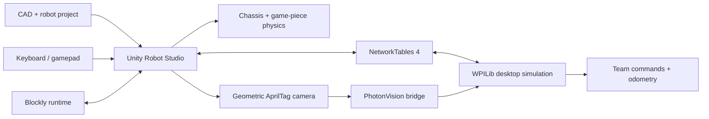

# Architecture

## Editable robot

`ProjectModel.cs` defines the portable project. `StudioApp.cs`, `StudioGui.cs`, `ModelLoader.cs`, and `RuntimeGizmo.cs` manage assembly, UI, imports, and recorded motion. Parts form a parent graph; actions target a part and can include its children through that graph.

## Training and physics

`TrainingWorld.cs` implements inventory, one-attempt-per-contact intake probability, HUB-entry counters, and optional return. `GamePieces.cs` provides rigid bodies and approximate shapes. `FieldWorld.cs` loads seasonal geometry, collision surfaces, and AprilTag layouts. Chassis motion follows terrain in the simple Unity drive mode.

`ReleasePose.cs` computes initial body attitude separately from velocity. Pose is applied once at release; gravity, contacts, and optional angular speed handle the rest. For coral, the tube's long axis follows the configured custom heading/inclination.

## Live data

`Nt4Client.cs` handles the connection, subscriptions, topic lifecycle, and bounded message queues. `MsgPack.cs` handles wire values; `NtData.cs` interprets supported pose, speed, and schema fields. `NetworkStudio.cs` exposes selection and action mapping.

`DriverInput.cs` normalizes common gamepad layouts. `RobotRunner.cs` owns Java processes launched from the app. `StudioBridge.cs` connects the bundled Blockly runtime to Unity on a local paired connection.

## Distribution boundary

Git contains source, seasonal assets, generic examples, and integration helpers. Windows player binaries are release assets. The public package contains no personal saved robots, private team robot project, or user CAD model. The seasonal model and dependency license notices remain with the assets.
