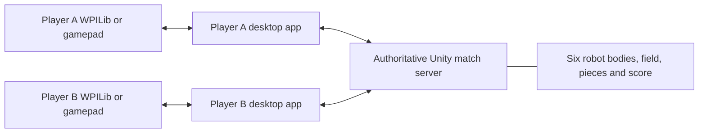

# Shared match architecture · 0.4.7

Native rooms, joining, shared physics and six-player sessions are implemented. See the [usage guide](online.md) for direct connections, WPILib setup, dedicated Windows hosting and current limits.

## Shared world, local code

Each participant runs their own robot code and local NT4 connection. A host or dedicated Unity server owns chassis collisions, game-piece IDs, inventory, capture probabilities, goals and match phase. Clients send drive/action requests. The server returns authoritative poses and the observations required by each robot's simulated sensors. Robot code and local credentials are not uploaded; robot models and configuration must be exchanged for rendering.

The existing observe-only path cannot produce consistent shared collisions: independent local poses would overwrite server displacement. Multiplayer needs the chassis-request/sensor-feedback path. A small simulation IO adapter feeds wheel/gyro inputs back into each team's normal odometry. Each player's camera observations must come from that same shared world and be isolated by robot identity.

## Session and timing

- A room assigns six identities, alliances and initial poses. Manual and WPILib-controlled players can mix.
- A ready barrier precedes a server-owned disabled/autonomous/teleop/end sequence. Season timing remains configurable until full rule handling is implemented.
- Timestamps, sequence numbers and disconnect timeouts prevent old inputs continuing to drive. Internet latency needs prediction/interpolation and explicit testing of automatic aiming stability.
- A piece can belong to only one inventory. Pickup probability and emission stock consumption run on the server once, rather than separately on every client.
- Model size limits, asset hashes and field versions are agreed before enabling the match.

## Implemented and verified

1. Two native processes: coherent chassis collisions and 456 shared pieces, with 80 ms added round-trip delay.
2. One real WPILib participant: shared displacement reaches wheel/gyro odometry, DriverStation and AprilTag feedback.
3. Six participants: manual/code input, ready/start/phase transitions, HUB totals, individual stock and disconnect handling.
4. Separate Windows hosting: six remote slots; configured public address; automatic start after the ready barrier.

`MatchTransport` bounds queues and message sizes and replaces obsolete unsent snapshots. Robots update at about 20 Hz and pieces at 10 Hz. Clients interpolate remote visuals and use kinematic piece replicas. `MatchFieldSync` shares moving REEFSCAPE cages too. Input older than 350 ms brakes; losing the host disables the local DriverStation bridge. Field geometry/tag signatures must agree. Shared projects strip NT endpoints, local code paths and Blockly contents.

The Windows app can open a temporary Cloudflare Quick Tunnel to a loopback WebSocket listener. The invitation key is checked before the upgrade. The host verifies the public TLS WebSocket address before showing the link. Direct TCP rooms still support reachable addresses and VPNs. The public tunnel was exercised by two processes on one PC, with the guest's traffic routed through Cloudflare. HUB totals are practice counters.

Reference: [Unity authoritative physics model](https://mp-docs.dl.it.unity3d.com/netcode/current/advanced-topics/physics/).
