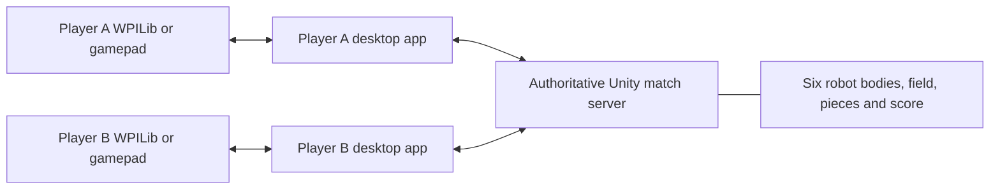

# Online match design — not implemented in 0.4.6

The current release is a single-player desktop application. This document defines the next multiplayer stage; it is not a claim that room joining, internet hosting or six-robot matches are available.

## Shared world, local code

Each participant runs their own robot code and local NT4 connection. A host or dedicated Unity server owns chassis collisions, game-piece IDs, inventory, capture probabilities, goals and match phase. Clients send drive/action requests. The server returns authoritative poses and the observations required by each robot's simulated sensors. Robot code and local credentials are not uploaded; robot models and configuration must be exchanged for rendering.

The existing observe-only path cannot produce consistent shared collisions: independent local poses would overwrite server displacement. Multiplayer needs the chassis-request/sensor-feedback path. A small simulation IO adapter feeds wheel/gyro inputs back into each team's normal odometry. Each player's camera observations must come from that same shared world and be isolated by robot identity.

## Session and timing

- A room assigns six identities, alliances and initial poses. Manual and WPILib-controlled players can mix.
- A ready barrier precedes a server-owned disabled/autonomous/teleop/end sequence. Season timing remains configurable until full rule handling is implemented.
- Timestamps, sequence numbers and disconnect timeouts prevent old inputs continuing to drive. Internet latency needs prediction/interpolation and explicit testing of automatic aiming stability.
- A piece can belong to only one inventory. Pickup probability and emission stock consumption run on the server once, rather than separately on every client.
- Model size limits, asset hashes and field versions are agreed before enabling the match.

## Delivery gates

1. Two processes on one LAN: coherent chassis collisions and shared pieces.
2. One WPILib-controlled participant: server displacement reaches gyro/odometry and AprilTag feedback.
3. Six participants: mixed control sources, ready/start/phase transitions, scoring and disconnect/rejoin.
4. Internet rooms: relay/reachable hosting, delayed/lost-packet tests and moving-shot stability.

A UI room button should ship only after these paths are usable. Merely broadcasting positions or exposing NetworkTables to other computers does not complete multiplayer physics.

Reference: [Unity authoritative physics model](https://mp-docs.dl.it.unity3d.com/netcode/current/advanced-topics/physics/).
