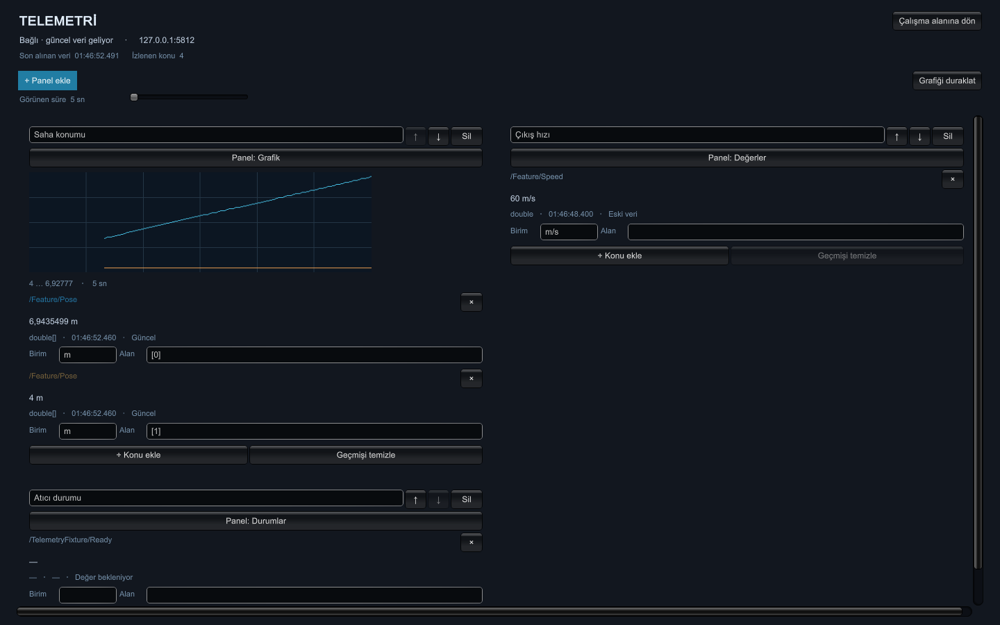

# Live telemetry

Open **Telemetri** from the studio or match toolbar. The workbench reads the same NetworkTables connection used by the rest of Ashina. Connect through **WPILib / NetworkTables**, then add a panel and choose an announced topic. A typed topic name can also be watched before it is announced.

| Panel | What it shows |
| --- | --- |
| **Grafik** | Up to eight numeric series, with color-coded topic names and a shared automatic value range. |
| **Değerler** | Latest numeric or text state, NT type, configured unit, receipt time and age status. |
| **Durumlar** | Boolean topics shown as **AÇIK** or **KAPALI** with the same timing and connection information. |

Rename the panel in its header. Move it using the arrow buttons and remove it with **Sil**. Enter a display unit or optional field such as `translation.x` below a topic. A unit label leaves the value unchanged. A plot's history can be cleared from its panel. A topic repeated across panels shares one history.

Use **Görünen süre** to zoom between 5 and 180 seconds. **Grafiği duraklat** freezes the graph viewport while incoming samples continue. Use **Zamanda kaydır** to review retained data, then **Canlıya dön** to return to current values. A disconnected or missing stream is shown as a gap. A stable value with no recent publication can be marked old. The display distinguishes that state from a disconnected socket.

The view samples the latest NT cache up to 25 Hz and redraws graph textures about seven times per second while open. There are at most eight panels, 32 configured series and 4,608 samples per distinct topic/field. This is live plotting at the sample rate. Use a dedicated logging tool to preserve every signal update at higher wire rates. The app stores the panel layout in `telemetry-v1.json` under Unity's application data directory. Robot files and room data do not carry the layout.

The native feature suite checks a real WPILib NT4 server, boolean and numeric values, multiple graph series, missing/stale sources, reconnect, sustained ring rollover, persistence, panel removal and repeated opening of the workspace. The suite exercises both chart rendering and the shared controls as part of the existing player verification.

The data layer lives in `TelemetryWorkspace.cs`. `TelemetryPlot.cs` renders the chart texture and `TelemetryStudio.cs` hosts the workspace. `TelemetryChecks.cs` uses the native player and WPILib fixture. Integration changes are confined to the NT4 receipt cache, the studio and match entry points, driver keyboard focus and the existing feature-check runner.
